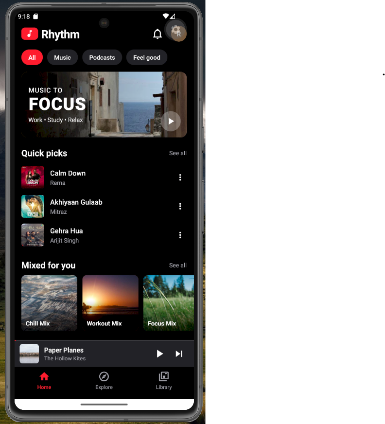
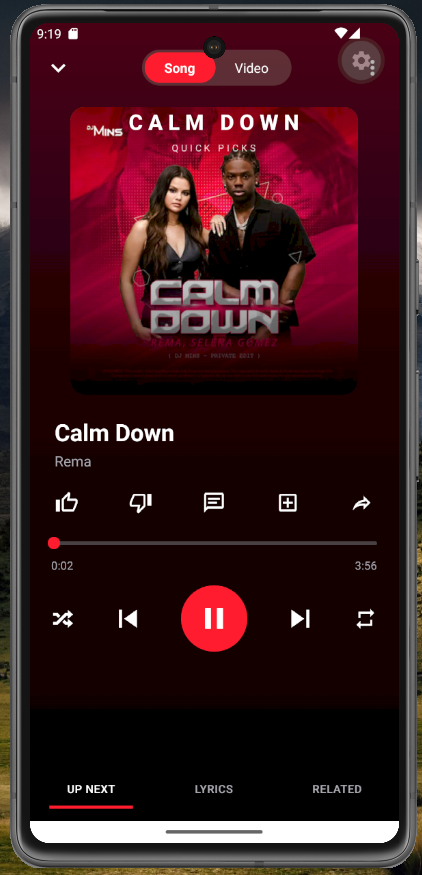
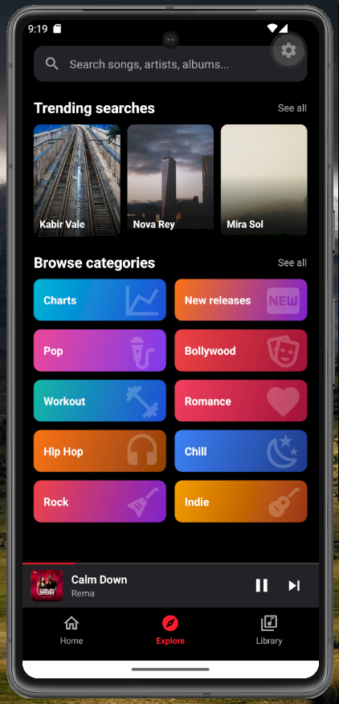
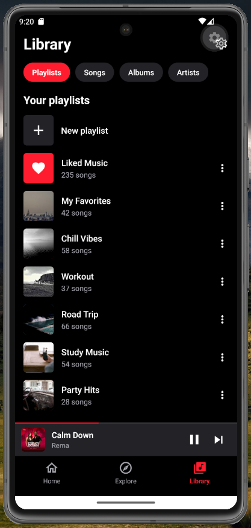
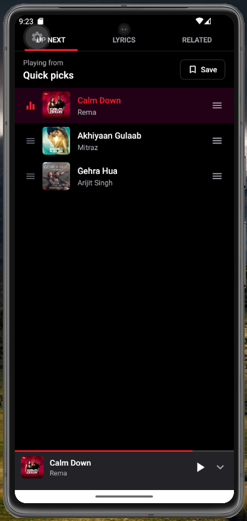
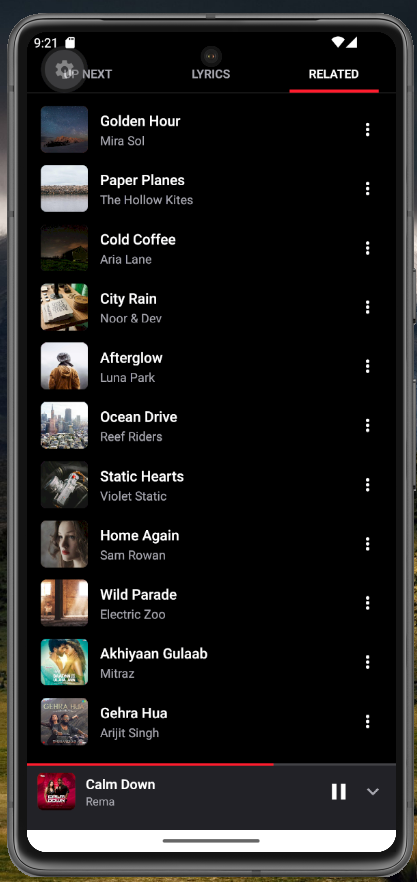

# 🎵 YouTube Music App Clone – React Native & Expo

A modern music streaming mobile application inspired by YouTube Music, developed using **React Native and Expo**.

This project showcases a modern music application UI with an immersive home screen, music discovery experience, and an interactive music player interface.

**Looking for the complete source code?**

🚀 **Get the Complete Project:**
👉 [Download the Complete Source Code on SkillHost](https://skillhost.in/projects/youtube-music-app-clone-using-react-native/)

---

## 📱 Project Preview

Explore selected screens and UI implementations from the application.

### 🏠 Home Screen

Discover music recommendations, trending tracks, playlists, albums, and a modern music browsing experience.

### 🎧 Music Player Screen

Experience an immersive now-playing interface with music artwork, track information, and playback controls.

### 🔍 Explore Screen

Explore the application's music discovery interface.

### 📚 Music Library

Preview the music library and playlist browsing experience.

### ⏭️ Up Next – Playback Queue

View and manage the upcoming songs in your current playback queue.

### 🔗 Related Songs – Music Discovery

Discover more music related to the currently playing track.

---

## ✨ Application Features

- Modern YouTube Music-inspired interface
- Dark-themed mobile UI
- Music discovery and recommendations
- Music search experience
- Music library interface
- Playlist and album presentation
- Immersive music player design
- Playback controls and track information
- React Native mobile application architecture

*Note: This repository contains selected UI source code and screenshots, not the complete runnable application.*

---

## 🛠️ Technology Stack

| Technology | Purpose |
|---|---|
| React Native | Mobile application development |
| Expo | Development and build environment |
| JavaScript | Application logic |
| React Navigation | Screen navigation, if used |
| Expo Audio | Audio playback, if used |

---

## 🚀 Get the Complete Source Code

Want to explore the complete YouTube Music-inspired mobile application?

The complete project is available on **SkillHost.in**.

### What you get:

- Complete React Native + Expo project
- All application screens
- Complete source code
- Required components and assets
- Project implementation and structure
- Full project files for development and customization

<kbd> </kbd>

👉 **[Download the Complete Project on SkillHost](https://skillhost.in/projects/youtube-music-app-clone-using-react-native/)**

---

## 🎯 Who Is This Project For?

- React Native developers
- Expo developers
- Mobile application development beginners
- Students learning music streaming application development
- Developers exploring modern music app UI design

---

## ⚠️ Repository Notice

This repository is intended for project showcase and educational purposes.

Only selected screen implementations and screenshots are published here. The complete application source code is not included in this repository.

For the full downloadable project, visit SkillHost.

---

## ⚖️ Disclaimer

This is an independent educational project inspired by YouTube Music. It is not affiliated with, endorsed by, or sponsored by YouTube or Google.

YouTube and Google are trademarks of their respective owners.

---

**Explore more developer projects and source code:**

🌐 [SkillHost.in](https://skillhost.in)
